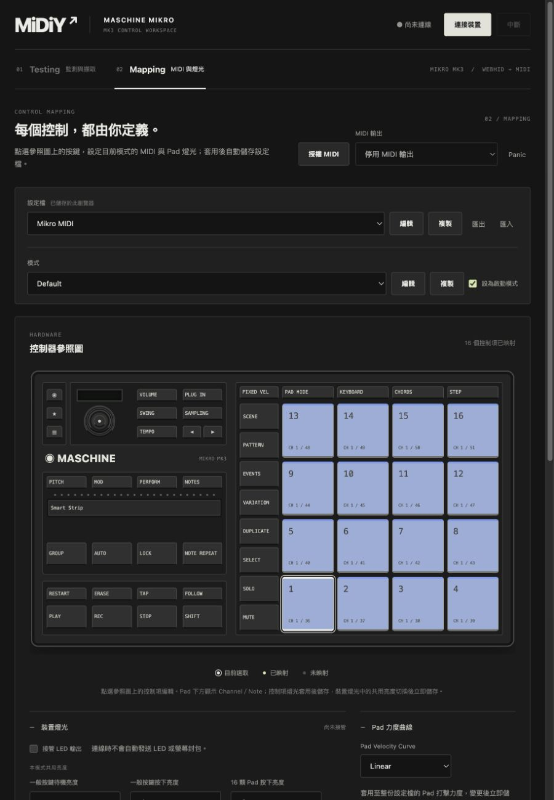
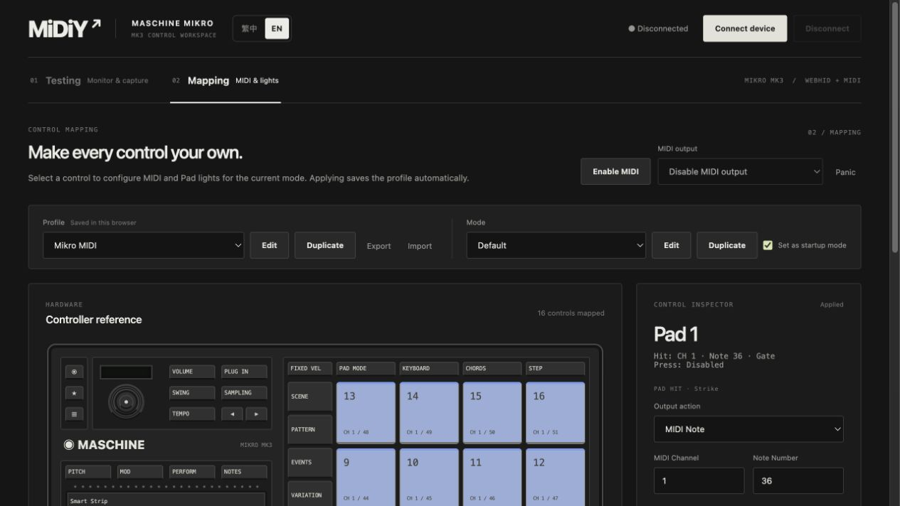

# 2026-10-21 第一輪重構驗證

## 基準與程式驗證

重構前 `npm test` 為 59 項通過，`npm run build` 通過。重構後為 69 項通過，正式建置（含核心 ESM／宣告、網站 TypeScript、Vite）通過。

保留原協定、映射、力度、壓力、共享音符、Profile Library／舊格式與 Adapter 測試。LED 生命週期測試改測 Runtime＋WebHID Adapter；硬體操作選取仍在 UI 層測試。

新增 Runtime／研究狀態測試確認：

- 無 DOM、window、localStorage 下，以假 Adapter 執行原始報告→MIDI。
- 研究訂閱者拋錯或修改副本不影響其他訂閱者與 MIDI；取消訂閱有效，狀態快照可獨立修改。
- 切輸出釋放舊端、Panic、拔除／重連、模式切換與重套用保留清音／held-control 行為。
- 力度與共用回饋設定更新不釋放正在發聲的 Note。
- LED 預設不接管，停用後不繼續生產；關閉取消待送一般畫面，最後全暗序列化於 in-flight 寫入之後，重複關閉共用流程。
- 連線途中關閉可完成；不支援 LED 的介面不發送回饋；持續壓力不重送相同 LED 畫面。
- 錄製／顯示上限、停止擷取、清除顯示、reset、舊 Session 匯入不影響 MIDI。

## 瀏覽器檢查

在本機 `http://127.0.0.1:4173` 使用內建瀏覽器操作，未授權／操作實體 HID 或 MIDI 埠。

- Mapping Pad 2 的 Note 37 草稿改為 60，切到 Testing 選 Shift 再返回：Mapping 仍選 Pad 2，欄位保留 60，尚未套用。
- 點其他 Mapping Pad 出現捨棄提示，取消後保留草稿；套用後圖上顯示 Note 60，重新載入仍保留。
- 測試後將 Pad 2 還原 Note 37 並套用；原有設定檔清單仍可讀。
- 匯入合成的 `mpa-session-v1`（2 reports／1 capture），確認候選分析與 1/58 coverage。
- JSON／CSV 下載成功；讀取下載檔確認 JSON schema 為 `midiy-session-v1`、2 reports／1 capture；CSV 保留既有欄位並有 3 個候選列。
- 清除顯示後，Session 仍為 2 reports／1 capture。
- 390×844 viewport 下，Testing 與 Mapping 的 document scrollWidth 均不超過 viewport；測試後還原 viewport。
- 最終重新載入未觀察到瀏覽器 error log。

## 本輪未驗證

實體 Mikro MK3、Logic Pro／Koala、實際 LED／壓力／Encoder／Strip 接收與實體斷線均未重新測試。pagehide 的瀏覽器終止時機不保證可完成最後輸出。既有實機結果只引用[歷史紀錄](2026-10-19.md)，不視為重構後的新實測。

ESP32、樹莓派、部署流程、BLE MIDI、第二種控制器均未實作，不列為驗證通過。

## 繁中與英文介面

加入繁中／英文介面後，`npm test` 共 74 項通過，`npm run build` 通過。語系測試涵蓋字典鍵／插值一致性、偏好選擇與獨立儲存鍵、翻譯參數跳脫、結構化錯誤，以及語言切換不改變 Runtime 狀態或觸發 MIDI／LED 輸出。

本機內建瀏覽器操作確認：

- 繁中／EN 按鈕位於裝置名稱右側；裝置名稱是獨立區塊，尚未實作裝置選擇器。
- Note 60、Pad 紅色草稿跨語言切換保留；未套用狀態保留。測試草稿捨棄，未儲存到既有 Profile。
- 中文設定檔名稱草稿與擷取備註跨語言切換保持原文；設定檔名稱測試以 Escape 結束，未儲存。
- 捨棄草稿提示顯示英文，取消後 Note 60 仍保留。
- Strip 的 CC／Relative／Resolution 40 草稿切回繁中後保留，動態欄位與選項翻譯正確。
- 英文 Testing 畫面除語言按鈕「繁中」外未觀察到未翻譯的中文介面文字；使用者輸入不納入翻譯。
- 英文選擇重新載入後仍保留，原 Profile 清單可讀；測試結束切回繁中。
- 390×844 下兩頁均沒有整頁水平溢出；語言按鈕維持在裝置名稱右側。測試後還原 viewport。
- 未觀察到瀏覽器 error log。

本次未重新進行實體控制器、DAW 或 LED 測試；先前實機驗證界線不變。
