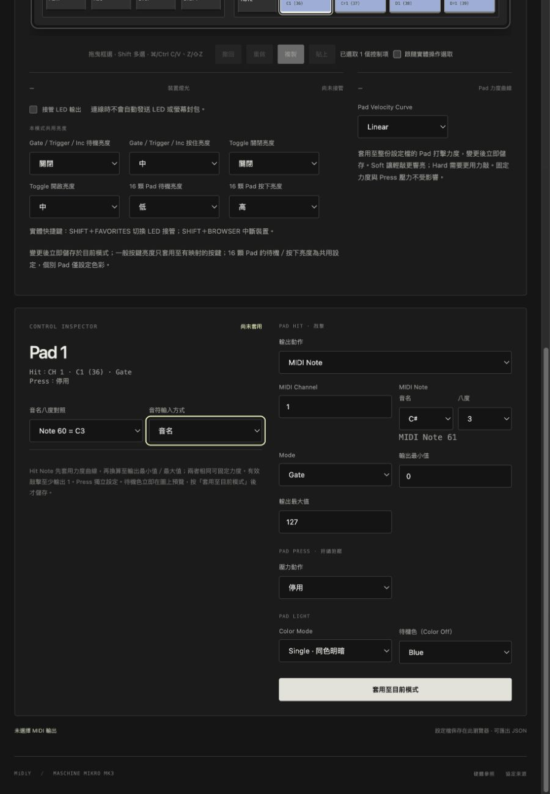
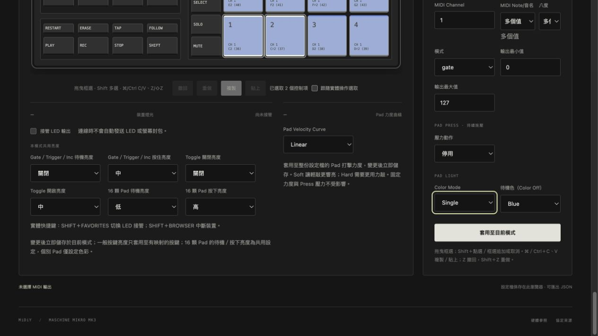
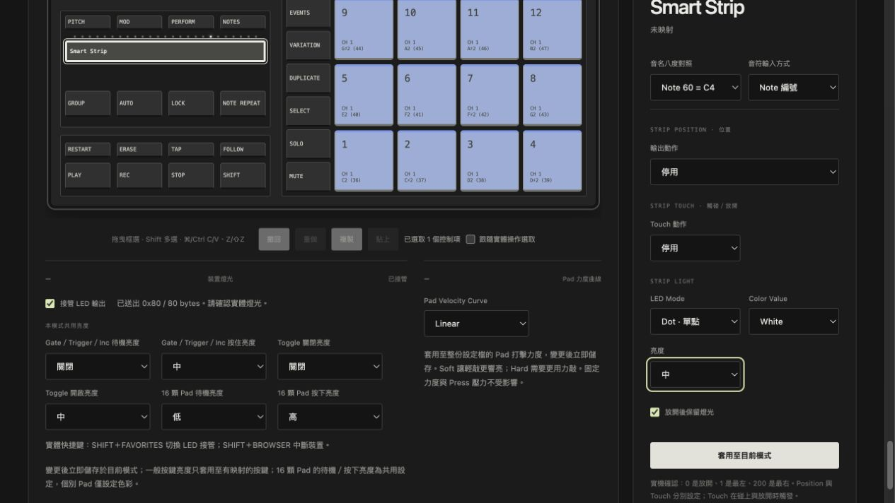

# 2026-10-23 Note 編號／音名輸入

## 程式與建置

- 開始時 MiDiY 工作樹乾淨；既有 105 項測試通過。
- 完成後 `npm test`：110 項通過、0 失敗。新增測試涵蓋三種八度對照的全部 128 個 Note 往返、音符邊界、獨立偏好儲存／無法存取儲存時的行為，以及真實 Runtime 搭配假 Adapter 的連線無副作用切換。
- `npm run build`：mikro-core 編譯、TypeScript 檢查與 Vite 正式建置通過。
- `git diff --check` 通過；Note 輸入整理階段未修改 Runtime、Driver、mikro-core 演算法或 Profile 格式。後續 Strip 調整見下節。

## 瀏覽器回歸

於本機 Vite `http://127.0.0.1:4173/` 的內建瀏覽器操作實際編輯器：

- 編號 61 的未套用草稿，在音名模式及 60=C3 時顯示 C♯3／MIDI Note 61；原映射仍為 36。燈色草稿保留。
- 切換繁中／英文及 Testing／Mapping，Note、燈色與尚未套用狀態保留；重新載入後顯示偏好保留，未套用映射沒有被儲存。
- Pad 摘要同時顯示音名與編號，編輯器欄位與偏好排列經畫面檢查。

另使用 [瀏覽器回歸工具](../../test/browser/note-preferences.html)，以實際 UI／Runtime 搭配假輸入與 MIDI Adapter、記憶體儲存：

- 模擬連線、選擇 MIDI 埠 a、接管 LED 後，切換偏好前後同一 Runtime、裝置資訊、MIDI 埠、Profile 皆保留；MIDI 發送數維持 0、LED 發送數維持 1、Runtime 事件數維持 6。LED 的 1 次是啟用接管產生的初始報告。
- 實際音名修改更新數字草稿，按套用後才更新 Profile。涵蓋 Pad Hit、Pad Press 門檻 Note／Poly Pressure、一般按鍵 Note／Poly Pressure、Strip Position Poly Pressure 與 Strip Touch Note／Poly Pressure。
- 多選不同 Note 維持混合空值；切換偏好不變更空值。只選音高的部分草稿也保留，選完八度後才新增批次 `hit.note`。批次音名 C3（60=C3）套用後兩個 Pad 的數字都是 60。另驗證批次 Pad Press 門檻音名，在偏好切換後保持 Note 48，套用後兩個 Pad 的壓力 Note 都是 48。
- 60=C4 下 Note 0 顯示 C−1、127 顯示 G9；最高八度停用 G♯／A／A♯／B。改成 60=C5 後 127 仍是 127，顯示 G10。

## 實機

未重新驗證實體 Mikro、WebHID 收送、實體 MIDI 埠或 DAW 發聲；模擬連線結果不代表實機結果。

## 單選／多選編輯器順序修正

- 多選改成與單選相同的 Hit → Press → Light；壓力動作放到 Press 區塊，移除重複的 MIDI / HIT 標題。
- Color Mode 排在待機色之前，門檻壓力 Note 排成力度 → 釋放門檻 → 觸發門檻。
- 音名欄位以單行「MIDI Note/音名」標示；英文為「MIDI Note/Pitch」，保留八度標示。混合值不再顯示重複的數字輸入欄。
- 瀏覽器比對單選／多選欄位順序，確認部分音名會在可操作的選單提示補齊；完整選取後，批次套用仍儲存數字 Note 60。繁中／英文標題切換正確。
- 修正後 110 項自動測試、正式建置與 `git diff --check` 通過；未重新測試實機。

## Smart Strip 放開保留燈光

- 新增隨模式儲存的 `stripLight.hold` 可選布林值，預設關閉；保持現有 Profile schema／儲存鍵。只保留顯示位置，MIDI 仍接收原始放開事件。
- `npm test`：114 項通過、0 失敗。新增涵蓋 Dot／Bar／Pan、實際 Note Off、缺省／關閉行為、不自動接管 LED、Profile／Library 與舊 schema 相容，以及 Panic、模式切換、重新套用、停用 LED、斷線／拔除／重連的清理。
- `npm run build`（含 core 編譯與型別檢查）及 `git diff --check` 通過。
- 瀏覽器以實際 UI／Runtime 和假 Adapter 驗證：預設未勾、勾選草稿不更新 Profile、改輸出動作保留草稿、套用後回讀 `hold:true`；模擬 Strip 放手後仍有非零燈光。取消勾選套用後，再碰觸與放開會全熄。英文標籤為 Keep light on after release。
- 未重新驗證實體控制器與 DAW；模擬報告不代表實機結果。

