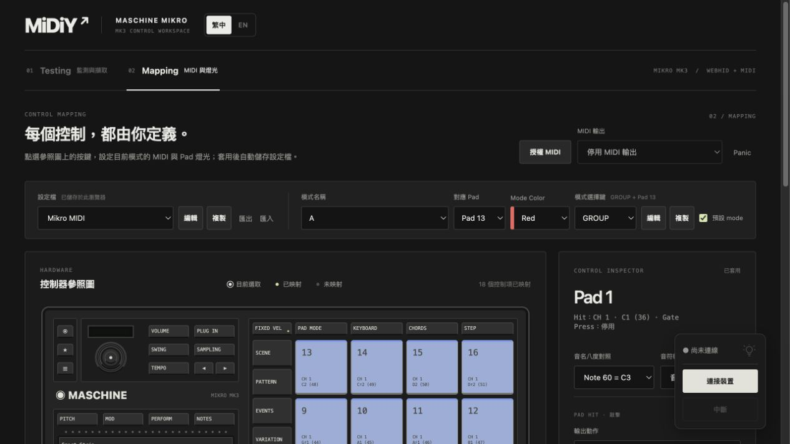

# 2026-10-24 設定檔與模式同列

- 寬視窗中，設定檔與模式置於同列。寬度優先留給設定檔及模式名稱；Pad、顏色、模式選擇鍵為短欄位。窄視窗保留換行。
- 移除下方整段選擇鍵提示，改在標題旁顯示目前快捷組合。瀏覽器確認 GROUP + Pad 13、PROJECT + Pad 1，以及未指定時的中英文顯示；換鍵、換 Pad 及模式切換會更新，未改動 MIDI／LED 流程。
- 121 項測試、npm run build、git diff --check 通過。瀏覽器檢查繁中與英文同列排版。
- 未重測實體裝置與 DAW。

