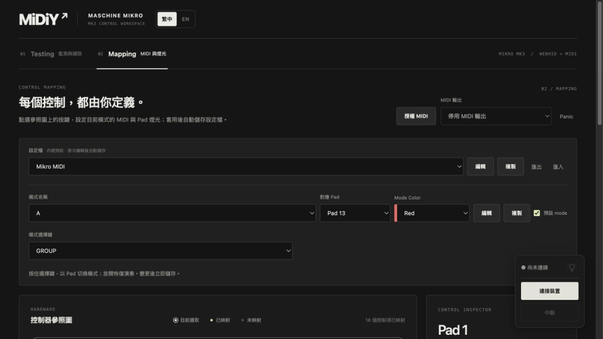

# 2026-10-24 LED 接管圖示移至連線面板

將原 Mapping 裝置燈光區的接管核取方塊移到右下角連線面板，置於連線狀態右側，以燈泡 SVG 表示。沿用 midi-led-enable ID 與 change handler，Runtime／Driver／Adapter 未修改。

- 啟用時圖示使用強調色，關閉時為灰色；未連線或沒有 Output Report 0x80 時停用。
- 保留原生 checkbox、可存取名稱與鍵盤焦點樣式。懸浮 title 顯示中英文用途、接管狀態及最近的狀態訊息。
- Mapping 中仍保留亮度設定及狀態訊息，不再重複提供接管開關。
- npm test：120 項通過；npm run build 與 git diff --check 通過。
- 瀏覽器 FakeInput／FakeMidi：連線後圖示可開關，checked 與接管摘要同步；切換 Testing 後仍存在，英文提示與可存取名稱更新。
- 實際應用頁面未連線時圖示停用，位於狀態文字右側；未重測實體 LED 或 DAW。

