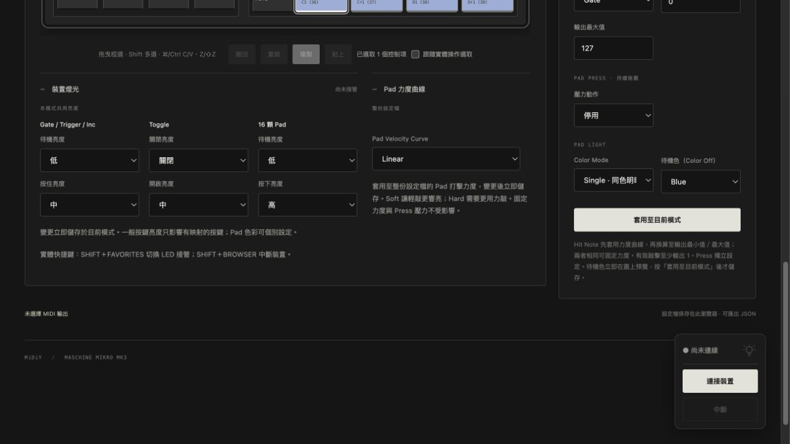
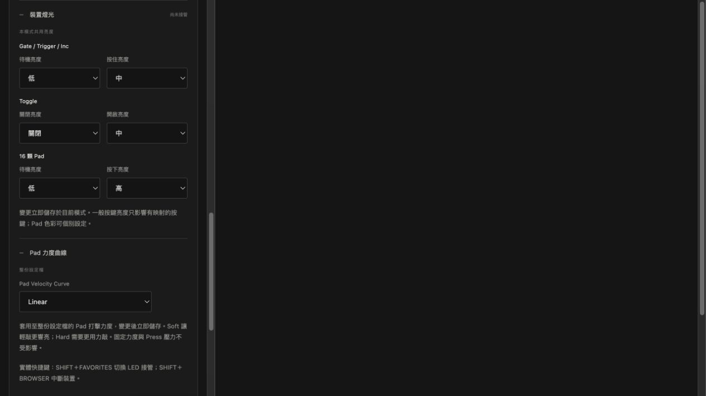

# 2026-10-24 燈光設定區整理

- 移除一般狀態的重複段落，只在燈泡提示顯示連線／送出狀態；設定區保留實際 LED 錯誤的狀態提示。
- 亮度依 Gate／Trigger／Inc、Toggle、16 顆 Pad 分成三組，固定欄寬；窄視窗每組成對排列。力度曲線標題與第一列欄位對齊，標出整份設定檔的適用範圍；快捷鍵說明統一放在下方。
- 保留原欄位 ID、值、立即儲存及 LED 生命週期。
- npm test：120 項通過；npm run build、git diff --check 通過。
- 瀏覽器：繁中／英文切換後標籤與亮度選項正確，英文 Medium 完整可見；一般按鍵待機亮度變更並儲存成功。390px iframe 欄位未水平溢出，臨時頁已移除。
- 未重測實體裝置／DAW。

