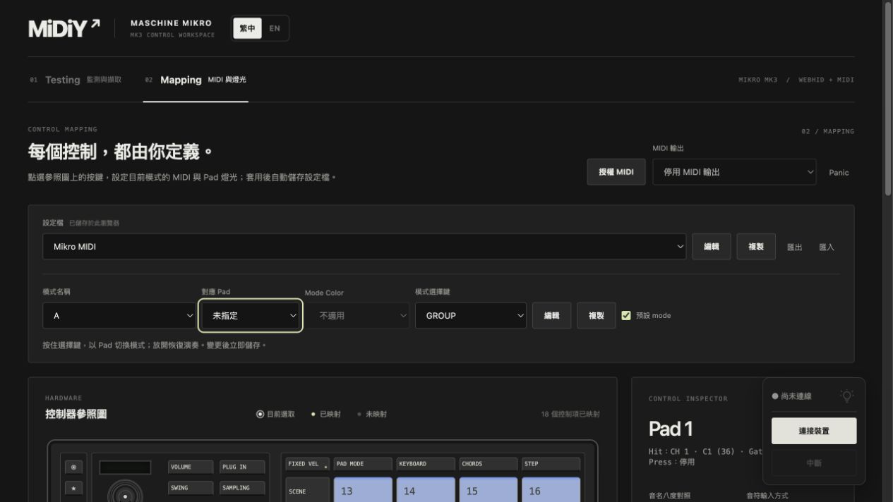

# 2026-10-24 緊湊模式列

- 縮短模式名稱欄，與對應 Pad、Mode Color、模式選擇鍵、編輯操作及預設 mode 同列。窄視窗換行。
- 未指定 Pad 時 Mode Color 停用、顯示不適用；不要求模式必須指定 Pad，也不改成共用控制項選擇欄。一般按鍵繼續使用既有切換模式動作。
- 瀏覽器確認未指定狀態的中英文顯示、停用狀態，以及重新指派 Pad 13 後恢復原色 Red。
- npm test：121 項通過，包含新增的未指定模式仍可由一般按鍵切換測試。npm run build 與 git diff --check 通過。
- 未重測實體控制器或 DAW。

