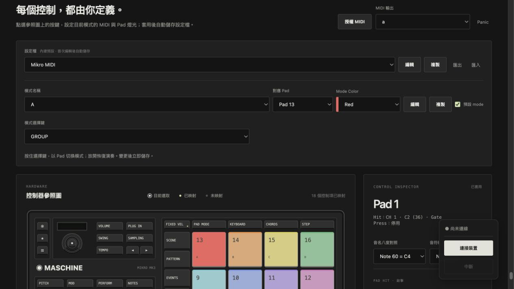
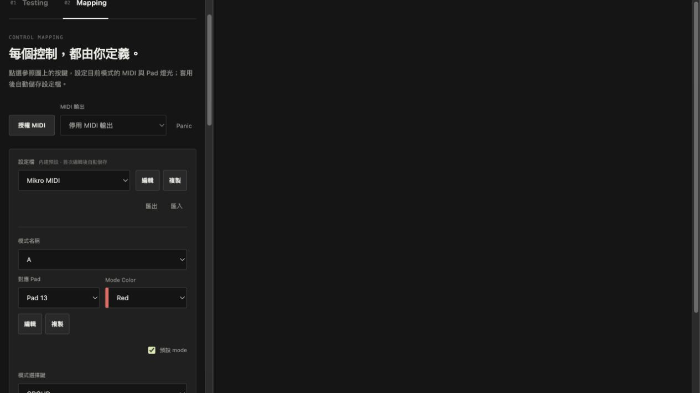

# 2026-10-24 GROUP 模式選擇

保留本輪開始前已有的 Profile v2 清理變更；未修改參考 driver checkout。

## 行為與設定

- 新建 Profile 有 A–H：A–D 對應 Pad 13–16，E–H 對應 Pad 9–12。其餘 Pad 可指派自訂模式。名稱、selectorPad 與 Mode Color 獨立。
- 按住預設 GROUP 進入選擇畫面：已指派 Pad 顯示模式顏色與名稱，空位不亮，目前模式較亮。按 Pad 切換，放開恢復演奏回饋。選擇用 Pad 的 Hit／Press／釋放不送 MIDI。
- 模式選擇鍵可更換，整份 Profile 共用；已有映射時先確認移除。保留 SHIFT、FAVORITES、BROWSER 的快捷鍵用途。
- FIXED VEL 預設在各模式的實體 FIXED VEL，值 127；可透過一般按鍵的輸出動作移動，每模式最多一個。
- 模式列依序為「模式名稱」、「對應 Pad」、「Mode Color」，「設為啟動模式」改稱「預設 mode」。複製模式時不複製 Pad 指派。
- MappingEngine 管理選擇狀態與 MIDI 抑制，Runtime 提供狀態，Driver 編碼燈光。LED 寫出仍須接管，草稿預覽不直接寫裝置。

## 本輪驗證

- npm test：120 項通過，0 失敗；新增 7 項模式選擇測試，涵蓋預設位置、唯一指派、顏色驗證、按住切換／事件抑制、清音／壓力、可換按鍵與 LED 接管。
- npm run build：core、TypeScript、Vite 建置通過。
- git diff --check 通過。
- 瀏覽器搭配 FakeInput／FakeMidi：按住 GROUP 顯示模式色；按 Pad 14 切到 B，放開恢復且 MIDI 發送數為 0。
- 模式 B 可改為 Pad 1、Blue；模式選擇鍵可改為 PROJECT。複製模式預設未指定 Pad，改名 Drums 並指定 Pad 1、Green 可儲存；PLAY 可配置固定力度 96，原 FIXED VEL 映射隨之移除。
- 英文切換後 Mode Name、Default mode、Mode Selector 與說明更新。
- 390px iframe 載入實際頁面，模式名稱、Pad、Mode Color、編輯／複製與預設 mode 可見且未水平溢出；臨時測試頁已移除。
- 未測實體控制器、實際 LED 或 DAW 接收，不能以模擬結果代替。

