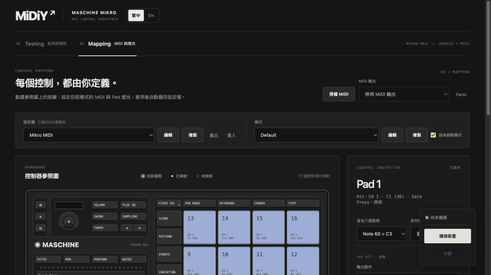
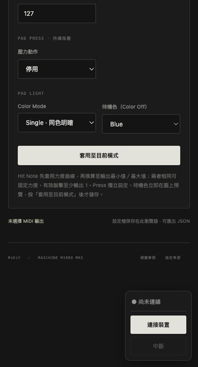

# 2026-10-24 固定連線面板

將裝置連線狀態、連接與中斷按鈕從頁首移至右下角直式浮動面板。保留既有 ID、事件與停用狀態，未修改 Runtime 或 Adapter；加入面板名稱的中英文翻譯。頁尾增加捲動留白，窄視窗縮小面板並讓 Toast 顯示於面板上方。

- 開始時工作樹乾淨。
- `npm test`：114 項通過，0 失敗。
- `npm run build`：core、型別檢查及 Vite 正式建置通過。
- `git diff --check` 通過。
- 本機內建瀏覽器：1280×720 視窗捲動前後面板座標相同（y=546.5，底部=696）；Mapping／Testing 皆顯示，繁中／英文切換正常，未連線時中斷按鈕停用。
- 以暫時的 390×720 iframe 載入實際應用檢查窄視窗，直式面板保持右下，捲至頁尾時套用按鈕及頁尾內容可移至面板上方。暫時檢查頁已移除。
- 未重新測試實體控制器連線或 MIDI 輸出。

