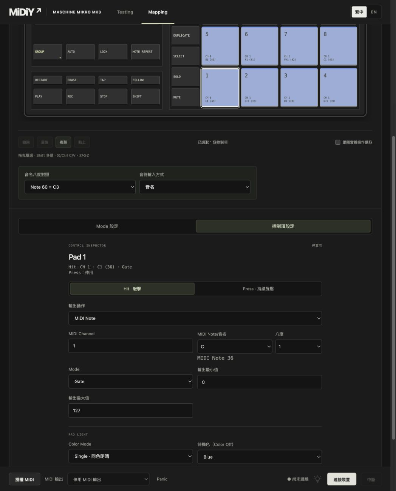
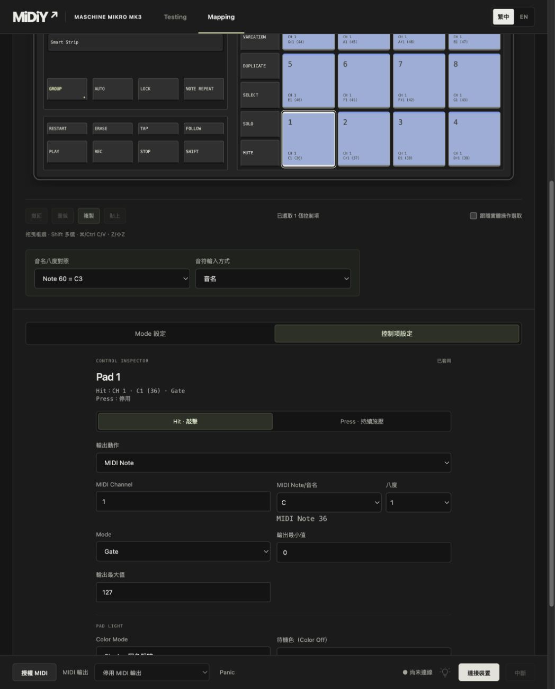
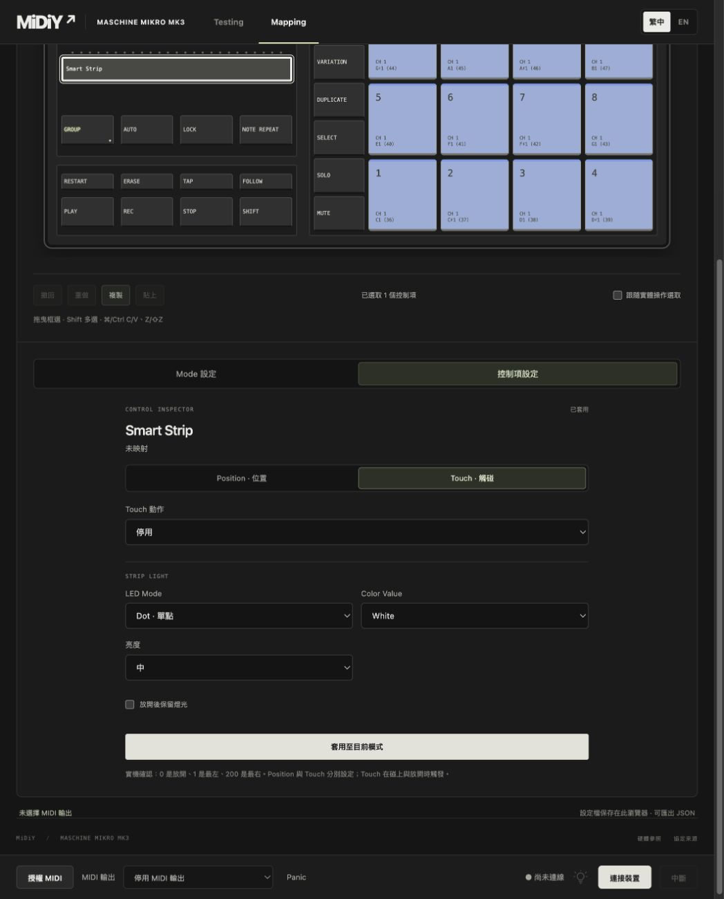

# 2026-10-26 Pad 與 Strip 映射分頁

- Pad 新增 Hit／敲擊、Press／持續施壓分頁，多 Pad 選取也適用。
- Strip 新增 Position／位置、Touch／觸碰分頁。一般按鍵／旋鈕不顯示這組子分頁。
- 沿用既有深色與綠色選取配色。Pad 色彩及 Strip 燈光留在分頁下方共用，保留原本欄位、草稿、預覽與序列化語意。
- 切換只更新 UI 狀態與隱藏屬性，不重建表單、不套用 Profile、不送 MIDI／HID。兩個分頁共用「套用至目前模式」，一次保存映射及共用燈光。
- 子分頁提供 tablist／tabpanel、選取狀態及方向鍵／Home／End 操作；驗證遇到另一子分頁的無效欄位時，先顯示該分頁再交給瀏覽器聚焦。
- 批次編輯改以整個映射表單委派欄位事件，涵蓋拆開後的 Hit、Press 與共用 Pad 色彩欄位。

## 驗證

- npm test：125 項通過。
- npm run build：核心套件、TypeScript、Vite 正式建置通過。
- git diff --check 通過。
- 隔離瀏覽器回歸：1440px 70 項、390px 66 項通過；沿用記憶體 ProfileLibrary、真實 UI／Runtime 及 FakeInput／FakeMidi。
- 新增確認切頁保留表單節點、草稿及 Profile，不新增 I/O；Hit／Press 可共同儲存，批次 Press 可從 Hit 頁套用；Strip Position／Touch 與 hold 燈光共同儲存；隱藏 Press／Touch 無效欄位會顯示；普通按鍵不出現子分頁；鍵盤切頁與既有 Testing 擷取回歸通過。
- 實際應用頁面另外目視檢查 Pad Hit、Press 與 Strip Touch，未更動該頁映射資料。
- 未重測實體 Mikro、LED 或 DAW。

