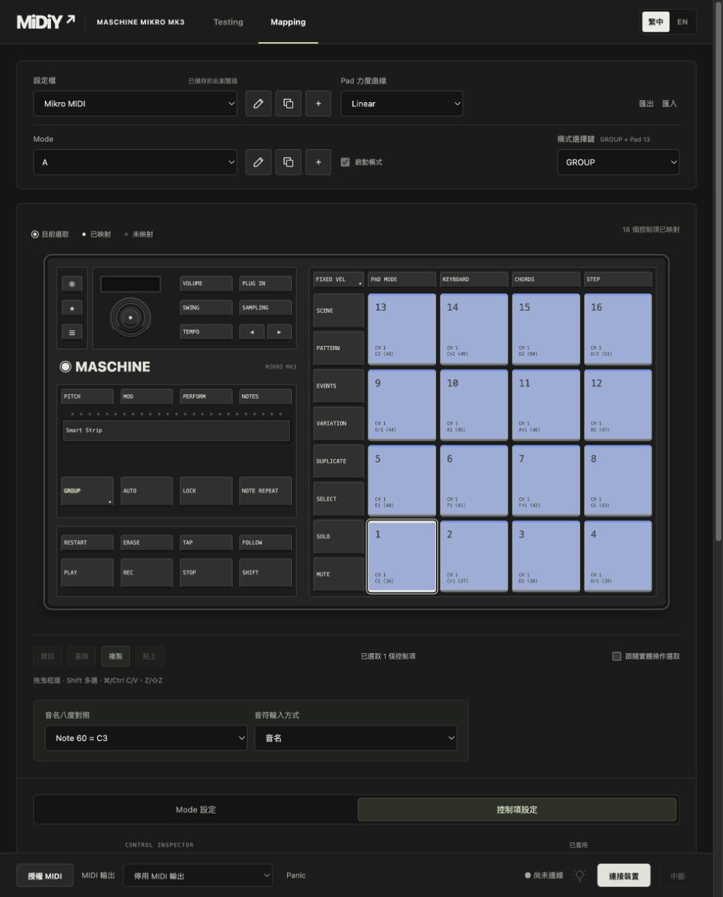

# 2026-10-26 畫布偏好、模式按鍵與圖示操作

依四項瀏覽器註記調整：

- 音名八度／輸入方式移到參照圖下方，只在目前映射表單含音符欄位時顯示；涵蓋 Note、Poly Pressure、Press、Strip Touch 與批次欄位。偏好維持瀏覽器設定，不寫入 Profile／Runtime 或套用草稿。
- Mode 設定改為顯示目前綁定，從畫布目前選取的單一 Pad／一般按鍵指派，另提供清除。重複佔用、模式選擇鍵、保留快捷鍵與不具一般按鍵燈號的 Encoder／Strip 不可指派。複製 Mode 清除 Pad 與按鍵指派。
- Profile 與 Mode 的編輯／複製改用 SVG 鉛筆與複製圖示，保留雙語 title／aria-label、Enter／Esc 及取消流程。
- Mode 與模式選擇鍵採固定 16px 標籤列、38px 輸入列。實際 1049px 瀏覽器量測兩個選單 top 均為 219px、高度均為 38px。

## 執行與格式

Profile 保持 midiy-profile-v2，Mode 新增可選 selectorButton，與既有 selectorPad 互斥；不新增其他舊格式讀取或遷移。未指定按鍵的 v2 Profile 保留 Pad 行為。

MappingEngine 處理模式按鍵與放開抑制；選模式時不送原本 MIDI，跨模式按住的按鍵須放開後才執行新映射。MikroDriver 負責單色按鍵的選擇畫面：目前模式 bright，其餘模式 dim，與既有 Pad 模式選擇畫面的亮度一致；放開模式選擇鍵後恢復普通映射燈光。實體輸出仍須先啟用 LED 接管。

## 驗證

- npm test：125 項通過，新增按鍵指派驗證、模式切換及放開抑制、跨模式 held 按鍵、選擇畫面燈號與 LED opt-in 測試。
- npm run build、git diff --check 通過。
- 隔離瀏覽器回歸：1440px 57 項、390px 53 項通過；使用記憶體 Library 與 FakeInput／FakeMidi，未修改實際頁面的 Profile。
- 新增檢查音名偏好的位置與條件顯示、按鍵取代 Pad、清除、重複佔用／保留鍵防護、模擬 GROUP＋PLAY 切模式與 dim／bright 燈號、圖示可存取名稱及選單對齊；延續 Testing 擷取回歸。
- 未重測實體 Mikro、LED、WebHID 授權及 DAW。模擬報告不能證明實體亮度或 DAW 接收。

