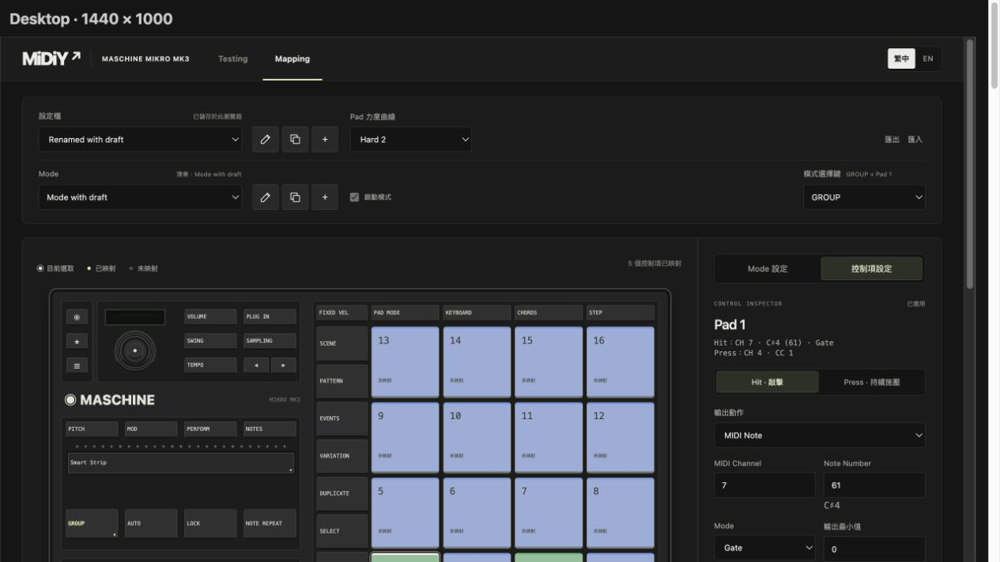

# 2026-10-26 裝置與功能分層整理

## 程式驗證

- 整理前：`npm test` 125 項通過；`npm run build` 通過。
- 整理後：`npm test` 133 項通過；`npm run build` 通過，包含 TypeScript 型別檢查與 Vite 正式輸出。
- 新增 EditorSession 與 Binding draft 測試，涵蓋草稿隔離、切換確認、複選、貼上、歷史副本、載入重設、儲存失敗仍保留已套用映射、失敗 undo 不前移游標，以及 Pad／Button／Encoder／Strip 的 v2 輸出。
- 核心套件演算法與 exports 未變更。共用 Adapter、Research、傳輸契約不引用 Mikro 核心；舊內部路徑已更新，未新增轉接空殼或舊設定遷移。

## 瀏覽器驗證

在本機 Vite 與 Codex 內嵌 Chromium 瀏覽器，使用真實 Mapping UI／Runtime、記憶體儲存與模擬 HID／MIDI 執行。

- 整理前的 workspace harness 通過；整理後 `/test/browser/workspace-preview.html` 在 **1440px 通過 87 項、390px 通過 83 項**，完整結果見[原始檢查輸出](2026-10-26-device-refactor-browser.txt)。
- 涵蓋 Profile／Mode 操作、瀏覽與演奏模式分離、Pad Hit／Press、Strip Position／Touch、驗證時顯示隱藏分頁、複選、預覽、語言切換、Note 顯示偏好、Research 擷取與分析、上下工作列、溢位與捲動。
- 新增內部複製／貼上及 undo／redo 快捷鍵檢查，確認貼上先停留草稿，套用前不儲存 Profile 或送出實體 I/O。
- Note 八度／輸入方式切換保留同一個標準數字欄位及未套用草稿，且不儲存 Profile 或送出 I/O。
- 在 note-preferences 測試頁以實際指標拖曳框選，選取結果為 `PAD_1`、`PAD_2`，畫面顯示「已選取 2 個控制項」。
- 樣式整理前先保存四份原始樣式的臨時副本；以相同新 UI 分別載入原始／整理後 CSS，在 **1440、900、390px** 的 Pad、Strip、Mode、Research 狀態比對可見元素的計算樣式與矩形位置，最終三種寬度皆無差異。比較時停用動畫／過場並排除焦點外框與 caret，避免跨 iframe 的焦點／時間差造成假陽性；不代表已逐一驗證所有 hover 或 pseudo-element 狀態。臨時比較工具與舊樣式副本在驗證後移除，避免留下第二份樣式來源。
- 回歸 harness 固定從 Mapping 開始，避免前次停在 Testing 的 hash 使重跑時頁面隱藏、造成鍵盤焦點檢查誤判。

## 實機驗證

本輪沒有連接實體 Mikro、DAW 或 MIDI 接收端。上述 HID／MIDI 計數是測試替身呼叫，不證明實體燈光或接收端結果。既有實機紀錄維持原狀，未宣稱重新驗證。
