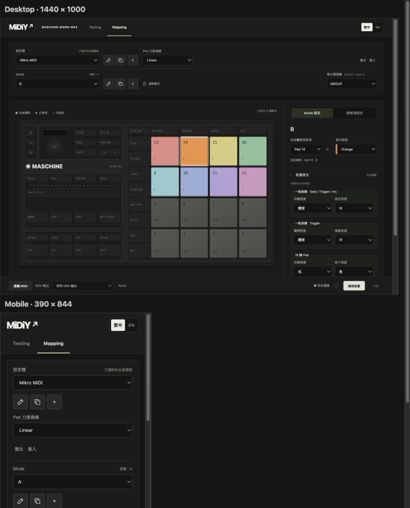

# 2026-10-26 模式指派預覽與編輯／演奏分離

- Mode Inspector 改以「目前觸發控制項」選單修改綁定，保留清除；移除畫布選取後的指派按鈕與說明段落。選單標示其他模式名稱並停用已佔用控制項，保留保留鍵／選擇鍵排除與 v2 驗證。
- Mode Inspector 的參照圖切換為模式指派預覽：Pad 名稱、模式燈色與一般按鍵單色亮度。編輯對象高亮，其餘已指派模式微亮，未指派控制項淡化。
- 點已指派項目查看其 Mode；點未指派項目保留編輯 Mode 並顯示狀態。進入 Mode Inspector 時，若無草稿或改名，會解析目前選取控制項的所屬 Mode。
- UI editorModeId 與 Runtime activeModeId 分離。上方 Mode 選單、模式瀏覽、建立／複製後的選取不再呼叫 runtime.switchMode；上方顯示「演奏：…」。瀏覽只更新 UI，純 Driver 編碼僅供網頁繪製，未呼叫裝置送出。
- 切回控制項 Inspector 恢復編輯 Mode 的 MIDI 預覽；跨 Inspector 保留映射草稿與色彩預覽。硬體模式切換不覆蓋 Mode Inspector 或映射草稿；乾淨的控制項 Inspector 保留跟隨實際模式的行為。Testing 繼續顯示實際演奏狀態。

## 驗證

- npm test：125 項通過。
- npm run build 與 git diff --check 通過。
- 1440px：81 項；390px：77 項隔離瀏覽器回歸通過。使用真實 UI／Runtime、記憶體 Library 與 FakeInput／FakeMidi。
- 實際模擬按住 Pad 音符後，切換 Inspector、點已指派 Pad、更換編輯 Mode、點未指派項目；確認音符仍保持、Runtime 模式不變、Profile 未被儲存、MIDI／HID 計數不增加。
- 檢查 Pad 名稱與亮度跟隨編輯 Mode、進入 Mode Inspector 自動解析選取對象、按鍵所有權瀏覽、選單佔用防護、觸發選單儲存／清除、硬體模式切換不覆蓋 Mode 瀏覽；延續 Pad／Strip 子分頁與 Testing 擷取回歸。
- 另在實際應用目視檢查：編輯 B、演奏 A，Pad 14 高亮並顯示 B，選單停用其他 Mode 的 Pad，未改動該頁 Profile。
- 未重測實體 Mikro、LED 或 DAW；模擬 I/O 計數僅證明此測試路徑的 UI／Runtime 邊界。

