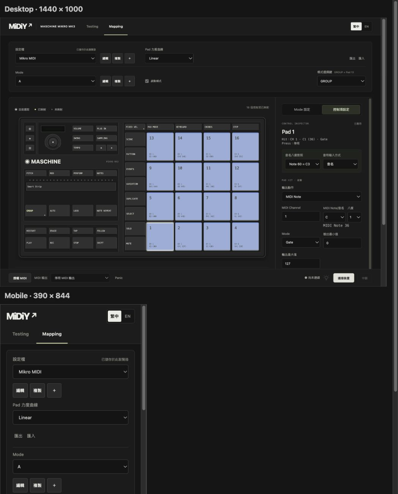
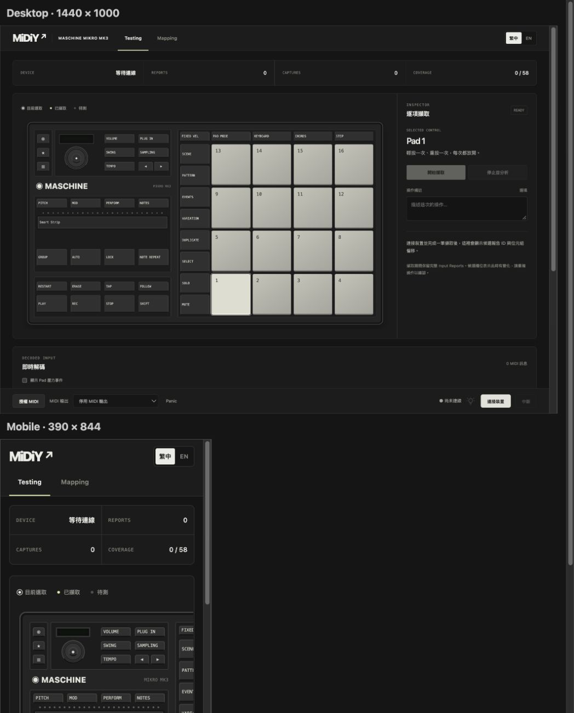

# 2026-10-26 UI 統一與 Testing 回歸

本紀錄接續當日的工作區分層改動，不改寫先前驗證結果。

## 介面

- 導覽列移到內容容器外，滿寬背景並固定於頁面頂端；上下列共用底色、最大內容寬度、左右留白及細分隔線，移除底部浮窗陰影與模糊。
- MIDI 控制置左、硬體連線與 LED 接管置右，按鈕／輸出選單等高並垂直對齊；窄視窗分兩列。
- Mapping／Testing 共用畫布＋Inspector 外框，桌面並排並以細線分隔，窄視窗上下排列。桌面 Inspector 可獨立捲動，預留固定導覽列與狀態列空間。
- Inspector 採分段式頁籤，Mode 標題顯示目前名稱，模式燈色使用雙語標籤；切換 Pad／燈色並排，亮度設定分組。畫布操作列分層並統一按鈕樣式。
- Testing 圖例移到畫布上方，統一擷取面板、統計列、資料區與表單間距。保留硬體圖比例、既有 Runtime／Driver／Adapter 及擷取流程。
- `workspace.css` 集中目前工作區版面規則。

## 驗證

- `npm test`：121 項通過。
- `npm run build`：核心套件、TypeScript、Vite 正式建置通過。
- `git diff --check` 通過。
- `test/browser/workspace-preview.html`：1440px 42 項、390px 39 項瀏覽器檢查通過。使用真實 UI／Runtime、記憶體 ProfileLibrary 與 FakeInput／FakeMidi。
- 延續新增／改名／複製／刪除／草稿／套用等操作檢查，加入上下列寬度對齊、MIDI／硬體左右位置、按鈕及選單高度、Mapping／Testing 捲動時導覽列固定。
- Testing 實際掛載：模擬裝置連線後啟動擷取、輸入三筆報告、停止分析，確認記錄及備註保存；切換語言保留未提交備註與已擷取記錄，並檢查頁面無水平溢出。
- 未重測實體 Mikro、WebHID 授權、LED 或 DAW。

