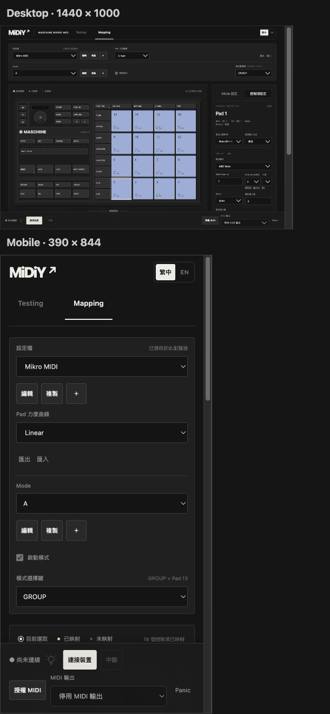

# 2026-10-26 工作區分層與底部狀態列

- 移除 Mapping／Testing 行銷標題，Logo、裝置、工作區頁籤與語言合併至頂部導覽列。
- Profile／Mode 分兩列；Profile 旁提供全域力度曲線，Mode 列保留啟動模式與 Profile 共用模式選擇鍵。
- 兩列一致提供編輯／複製／新增。編輯原地替換名稱輸入框，綠色 ✔／Enter 儲存、原色 ✕／Esc 取消，紅色刪除圖示需確認。新增是空白映射；新 Profile 只有一個 Mode，取消改名保留新項目。改名不套用控制項草稿。
- Inspector 分成 Mode 設定／控制項設定。Mode 收納切換 Pad、模式燈色及共用亮度；畫布只選取，另外按按鈕指派 Pad。
- WebHID 連線、LED 接管、MIDI 授權／輸出及 Panic 共用底部常駐狀態列，內容保留底部空間。

## 程式驗證

- `npm test`：121 項通過。
- `npm run build`：核心套件、TypeScript 與 Vite 正式建置通過。
- `git diff --check` 通過。

## 瀏覽器驗證

`test/browser/workspace-layout.html` 使用實際 TranslatorUI／Runtime、記憶體 ProfileLibrary 與 FakeInput／FakeMidi；不修改瀏覽器既有 Profile。`test/browser/workspace-preview.html` 將此測試嵌入 1440 × 1000 與 390 × 844 viewport。加 `?live` 可顯示實際應用的兩種尺寸。

- 1440px：32 項檢查通過；390px：31 項檢查通過。
- 涵蓋空白新增、複製、刪除確認、Enter／Esc／取消按鈕、改名輸入框寬度、啟動模式、畫布 Pad 指派、切換 Inspector 草稿保留、改名不套用草稿、既有映射套用、力度與亮度立即儲存、語系切換保留名稱草稿、Testing 共用狀態列、v2 Library 重載。
- 檢查頁面無水平溢出、狀態列貼齊底部及內容保留足夠空間；桌面額外檢查 Inspector 與畫布並排。硬體圖沿用原比例，在窄視窗內可水平捲動。
- 測試等待原生 dialog 的 close 完成後才檢查刪除結果，避免將非同步事件順序誤判為刪除失敗。

## 實機範圍

未重測實體 Mikro、LED、WebHID 授權或 DAW 接收。模擬 I/O 僅證明網頁與 Runtime 互動，不代表實體通訊成功；歷史驗證結果未改寫。

