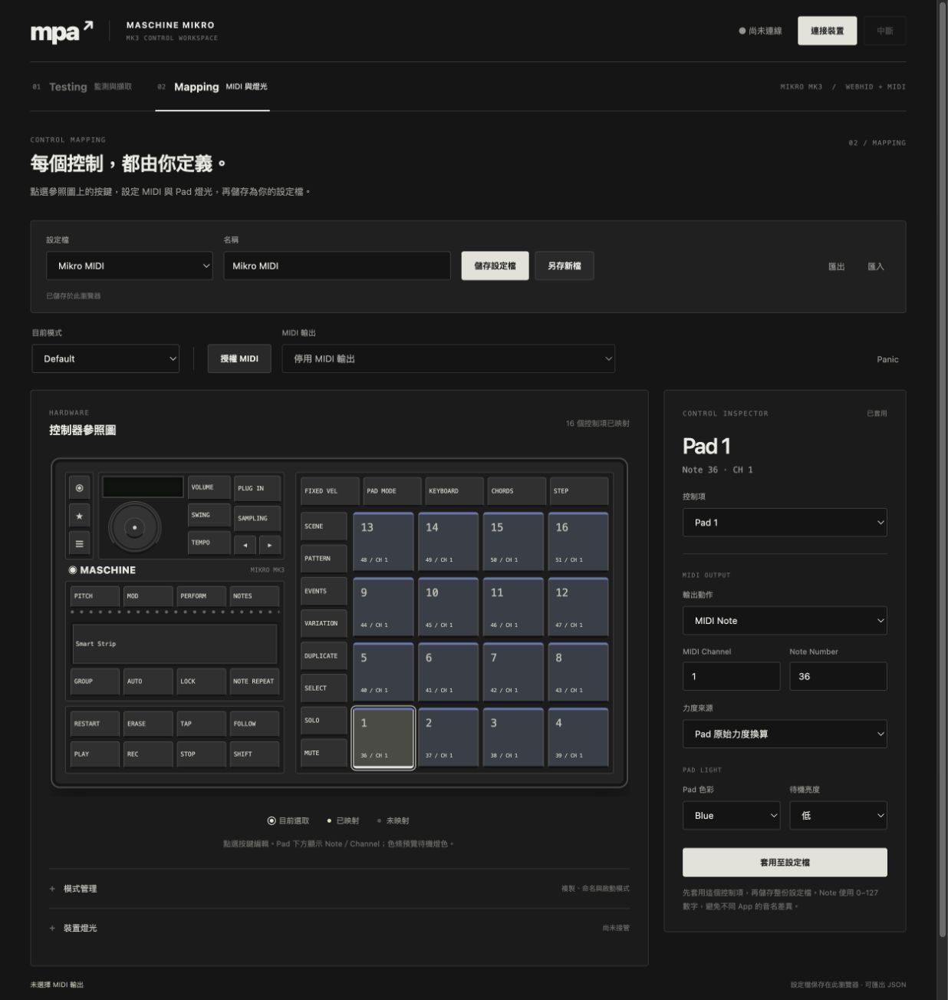
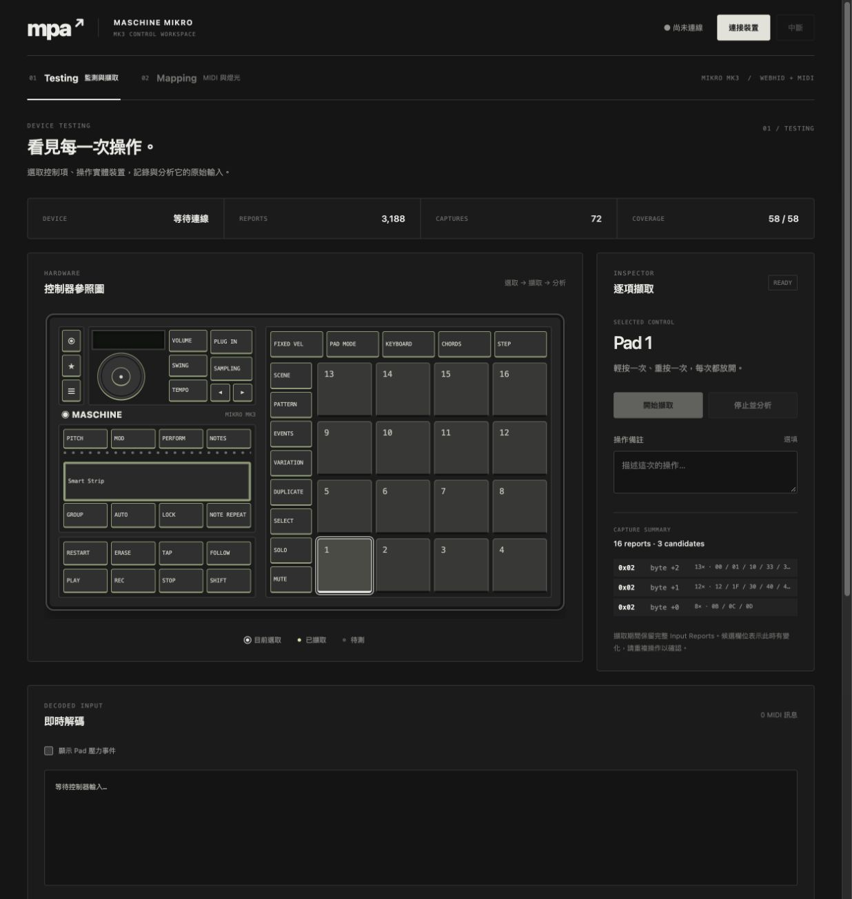
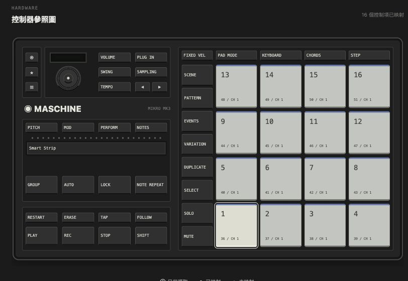
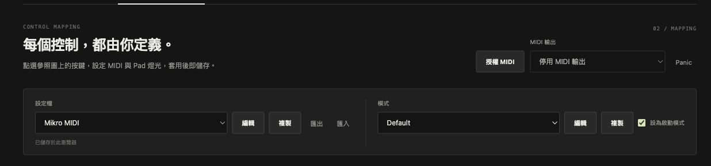
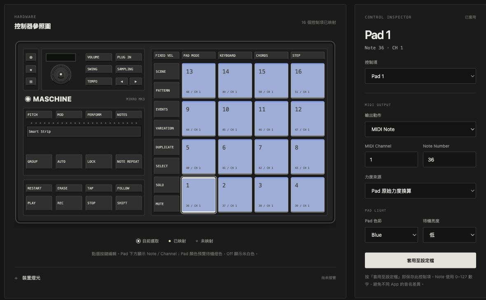
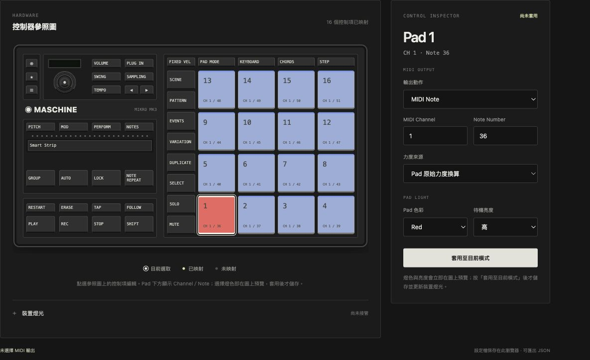
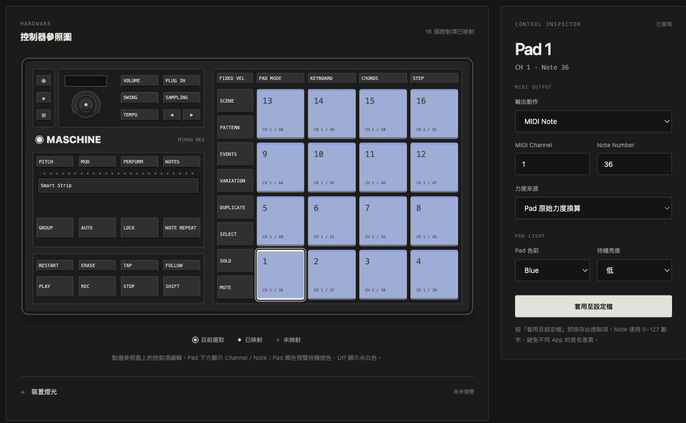
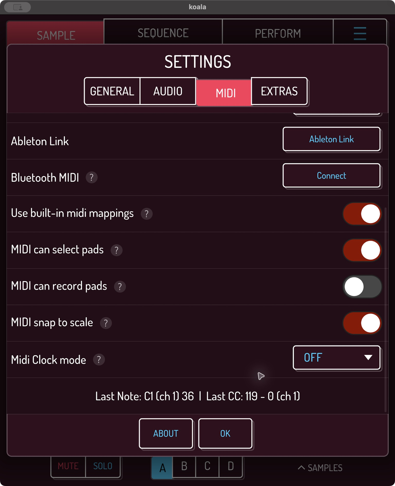

# 2026-10-19 驗證紀錄

## 程式與封包

- 26 項測試通過：Rust 協定規則、全 16 Pad、按鍵、Encoder／Strip、短封包與未知事件、映射與釋放、設定檔、LED、Adapter、原有分析功能及本機設定檔清單。
- 舊 `mpa-session-v1` 的 3188 筆原始報告可讀取，既有候選分析測試通過。
- 核心 ESM／型別宣告、網站型別檢查與 Vite 正式建置通過。
- 套件打包清單包含 ESM、型別宣告、README 與 MIT LICENSE。
- 瀏覽器儲存及設定匯出／匯入已確認；設定解析／往返有自動測試。

## Testing／Mapping 工作區改版

以下在實際瀏覽器頁面操作確認：

- 兩頁各自顯示參照圖及編輯內容；Testing 選取 Shift 不會改動 Mapping 的 Pad 選取。
- Mapping 修改 Pad 2 為 Note 60 後，切換 Testing 再返回，表單草稿仍在。
- 將草稿另存為 Studio，圖上更新 Note 60；重新整理後仍可載入。原 Mikro MIDI 的 Pad 2 仍為 Note 37。
- 當時設定匯出為 `mpa-profile.json`，再選取同一檔案匯入，顯示正確名稱與尚未儲存狀態；目前匯出名稱為 `midiy-profile.json`。
- 切換設定檔前取消提示，名稱草稿保留；選擇捨棄後，載入原設定檔。單鍵草稿的取消／捨棄亦確認。
- Testing 匯入舊 Session，顯示 3,188 reports、72 captures、58/58 coverage，以及 Pad 1 的候選分析。
- 390px 窄視窗下，頁面沒有水平溢出；參照圖可獨立水平捲動，編輯器排在下方。

此次介面改版未重新執行實體 DAW／LED 測試；下節為先前已完成的實機紀錄。

### 控制器比例修正

依使用者提供的硬體參照圖調整左半部：上方控制區、Logo、演奏區、間隔及走帶區分別占高度
25%、10.5%、40.5%、2.5%、21.5%。旋鈕內外圓同心並對齊螢幕中心，短鍵共用高度；
Volume／Swing／Tempo 與下方第三欄共用欄寬及對齊位置。

右上五欄與 Scene／Pad 13–16 逐欄同寬、同左緣，兩排間距固定為 8px。
Strip 底部約在 Variation 下方 2px，距 Duplicate 上緣約 2px。
已在瀏覽器量測 680px、920px 圖寬及兩個工作區；中心與欄位差小於 0.01px（次像素取整）。

Strip 上方改為 25 顆獨立燈珠，與 Pitch 列留出間距；觸控面高度介於 Pitch 與 Group 按鍵之間。
16 個 Pad 的未亮燈外觀為半透明米白色；Mapping 會以整塊 Pad 的顏色預覽設定的燈色與亮度，只有 Off 顯示米白色。
在 680px 圖寬下確認燈珠數量、Strip 底緣及 Duplicate 間距，窄視窗沒有頁面水平溢出。

### 設定檔與模式操作

設定檔與模式在桌面寬度並排；各自按「編輯」後，下拉欄位切換為名稱輸入，按鈕切換成「儲存／刪除」。
「複製」建立獨立副本並進入命名狀態；模式列可指定啟動模式。MIDI 授權、輸出埠與 Panic 位於 Mapping 標題右側。

使用獨立的 `localhost:4173` 瀏覽器儲存區驗證：設定檔改名、模式改名、模式與設定檔複製、兩種刪除確認、匯入後建立新設定檔，
以及 Pad 2 改為 Note 60；重新整理後，啟動模式與 Pad 映射仍在。桌面兩列並排且選單頂部對齊，390px 視窗改為上下排列且頁面沒有水平溢出。

### Pad 燈色預覽

Mapping 的控制器圖會以整塊 Pad 顯示目前模式設定的顏色，選取外框不會覆蓋燈色；亮度會影響預覽深淺。
在獨立的 `localhost:4173` 儲存區驗證：Pad 1 設為 Red／高並套用後顯示紅色；改為 Off，或 Red／關閉並套用後，恢復米白色。

選擇 Pad 色彩或亮度後，左側該 Pad 立即顯示草稿色，右側標示「尚未套用」；切換 MIDI 動作仍保留燈色草稿。
獨立 `localhost:4173` 儲存區驗證：未套用的紅色重新整理後回到藍色；按「套用至目前模式」後重新整理，紅色與高亮度仍在。測試後已還原藍色／低亮度。

### 控制項選取與 Pad 資訊順序

Mapping 右側移除重複的控制項下拉選單，改由左側參照圖選取。Encoder 觸碰可選取旋鈕中環；Testing 的 58 個擷取目標與舊工作階段覆蓋率維持原樣。
Pad 下方與右側映射摘要均以 Channel 在前、Note 在後顯示，符合編輯欄位順序。瀏覽器確認 MUTE、Encoder 觸碰與 Pad 1 可從參照圖選取，Pad 1 顯示 `CH 1 / 36`。

## 裝置與 App

| 項目 | 實測結果 | 證據範圍 |
| --- | --- | --- |
| WebHID 連線與 LED | 通過 | 使用者確認僅 Pad 1（最下排最左）亮紅燈；報告 ID `0x80`，payload 80 bytes |
| Logic Pro Note | 通過 | 選用 Logic Pro Virtual In；使用者確認敲 Pad 有聲音 |
| Koala Note／CC | 通過 | 網頁選 IAC bus；實體 Pad 1 及 Shift 操作後，Koala 顯示 Note 36、CC119 值 0，Channel 1 |
| Logic Pro CC | 待確認 | 網頁送出不代表接收端已確認 |
| Encoder／Strip 校準 | 待確認 | 回繞範圍與 Strip 有效端點可設定，目前未宣稱已校準 |
| 實體斷線清音 | 待確認 | 已測試程式釋放邏輯；埠失效時無法保證最後的 Note Off 能送達 |

Koala 測試時，Shift 暫設 CC119（按下 127、放開 0），以免更動現有 CC1／CC4 映射。
網頁事件記錄包含 `90 24 40`、`80 24 00`、`b0 77 7f`、`b0 77 00`。
測試後 Shift 已恢復停用並儲存；預設仍只有 Pad 1–16 的 Note 36–51 映射。

其他 Pad 色彩／亮度、完整 DAW 映射流程尚未逐項實測。螢幕與組合鍵依計畫留待下一階段。
